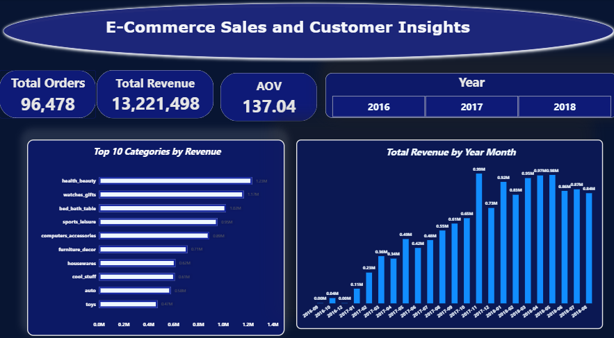
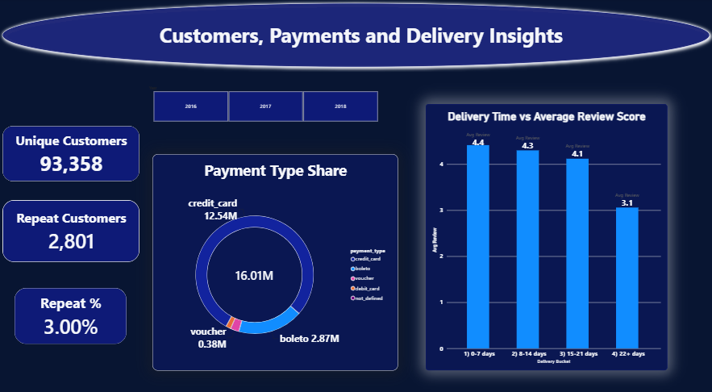

# E-Commerce Sales and Customer Insights

An end-to-end data analytics project: raw e-commerce data → MySQL → SQL analysis → Power BI dashboard → business insights.

## Project Overview

Online stores collect thousands of orders, but decisions are often made on instinct. This project analyses a real marketplace dataset to answer three questions:

1. Which products and categories drive revenue?
2. Who buys, and do customers come back?
3. How does delivery speed affect customer satisfaction?

## Dataset

- **Source:** [Brazilian E-Commerce Public Dataset by Olist (Kaggle)](https://www.kaggle.com/datasets/olistbr/brazilian-ecommerce)
- **Size:** 99,441 orders, Sep 2016 to Oct 2018
- **Tables used (8):** orders, order_items, order_payments, order_reviews, customers, products, sellers, category_translation
- **Scope:** Analysis uses **delivered orders only** (96,478 orders). Revenue means **product price**; the dataset has no discount or profit data.

## Tools Used

- **MySQL** and MySQL Workbench: data loading, cleaning, SQL analysis
- **Power BI Desktop:** data model, DAX measures, interactive dashboard
- **PowerPoint:** project presentation

## Workflow

1. Downloaded the dataset and loaded the CSV files into a MySQL database (`olist_ecommerce`).
2. Cleaned the data: converted order date columns from text to `DATETIME`, replaced blank values with `NULL`, checked for duplicates, and handled products without a category.
3. Wrote 8 SQL queries to answer the business questions.
4. Built a Power BI data model (7 relationships) and DAX measures, then a 2-page dashboard.
5. Wrote insights and recommendations.

## Data Model

`customers` → `orders` → `order_items` → `products` → `category_translation`

`orders` also connects to `order_payments` and `order_reviews`, and `sellers` connects to `order_items`.

## SQL Analysis

| # | Business question | File |
|---|---|---|
| 1 | What is the monthly revenue trend? | [01_monthly_revenue.sql](sql/01_monthly_revenue.sql) |
| 2 | Which categories bring the most revenue? | [02_top_categories.sql](sql/02_top_categories.sql) |
| 3 | How many customers buy again? | [03_repeat_customers.sql](sql/03_repeat_customers.sql) |
| 4 | Which states have the highest sales? | [04_state_sales.sql](sql/04_state_sales.sql) |
| 5 | How does delivery time relate to review score? | [05_delivery_vs_review.sql](sql/05_delivery_vs_review.sql) |
| 6 | Which payment methods are used most? | [06_payment_type.sql](sql/06_payment_type.sql) |
| 7 | What are the overall KPIs (orders, revenue, AOV)? | [07_kpis.sql](sql/07_kpis.sql) |
| 8 | Which categories have the lowest ratings? | [08_lowest_rated_categories.sql](sql/08_lowest_rated_categories.sql) |

SQL concepts used: joins, `GROUP BY`, `CASE WHEN`, CTE (`WITH`), subqueries, date functions, `HAVING`.

## Dashboard

**Page 1: Sales Overview** (KPI cards, monthly revenue, top 10 categories, year slicer)



**Page 2: Customers and Delivery** (repeat customers, payment share, delivery time vs review score)



## Key Numbers

| Metric | Value |
|---|---|
| Delivered orders | 96,478 |
| Total revenue (product price) | R$13,221,498 |
| Average order value | R$137.04 |
| Unique customers | 93,358 |
| Repeat customers | 2,801 (3.00%) |

## Key Insights

**1. Revenue peaks in November 2017.**
The peak month is Nov 2017 at R$987,765. This may be linked to Black Friday, but the data does not prove the reason.

**2. Three categories lead.**
health_beauty (R$1.23M), watches_gifts (R$1.17M) and bed_bath_table (R$1.02M) together bring about 26% of revenue. bed_bath_table is a volume category (about R$110 per order); watches_gifts is a high-value category (about R$212 per order).

**3. Only 3% of customers order again.**
2,801 of 93,358 customers placed more than one order. Retention is a major opportunity.

**4. Credit card dominates payments.**
Credit card is 78.34% of payment value, boleto 17.92%, voucher 2.37% and debit card 1.36%.

**5. Slow delivery is linked to lower ratings.**

| Delivery time | Orders | Avg review |
|---|---|---|
| 0-7 days | 30,679 | 4.41 |
| 8-14 days | 37,985 | 4.30 |
| 15-21 days | 16,170 | 4.12 |
| 22+ days | 11,519 | 3.06 |

**6. Sales depend heavily on SP.**
SP brings R$5.07M (about 38% of revenue), ahead of RJ (R$1.76M) and MG (R$1.55M).

**7. office_furniture has the lowest rating** (3.52) among categories with 100+ orders, with 1,244 orders.

## Recommendations

- **Store owners:** stock top categories; review weak ones such as office_furniture.
- **Marketing team:** run loyalty and win-back offers; plan campaigns before November.
- **Operations team:** cut deliveries over 21 days and set realistic delivery promises; protect delivery performance in SP.

## Limitations

- Data covers Sep 2016 to Oct 2018 and one marketplace.
- Revenue is product price only (no profit or discount data).
- Findings show association, not cause (for example, late delivery and low ratings).

## Next Steps

- Analyse delivery delay by state.
- Segment customers with RFM analysis.
- Repeat the analysis on an Indian e-commerce dataset.

## Repository Structure

```
├── sql/            8 SQL query files
├── screenshots/    Power BI dashboard screenshots
├── dashboard/      Power BI file (.pbix)
├── E-Commerce_Sales_Customer_Insights.pptx
└── README.md
```

## Author

**Archana H**: BCom (Corporate Secretaryship), Data Analytics
[LinkedIn](https://www.linkedin.com/in/archana-h-5b90012a6) | [GitHub](https://github.com/archanaarchanah0812-lgtm)
